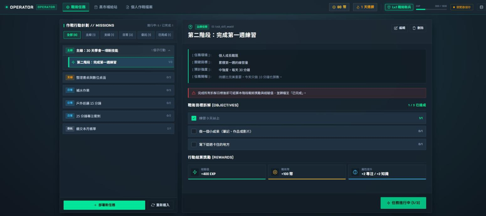
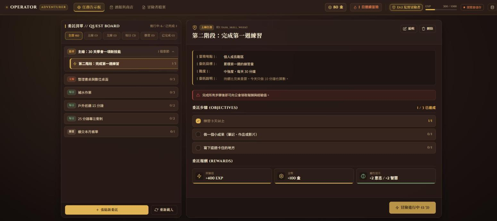
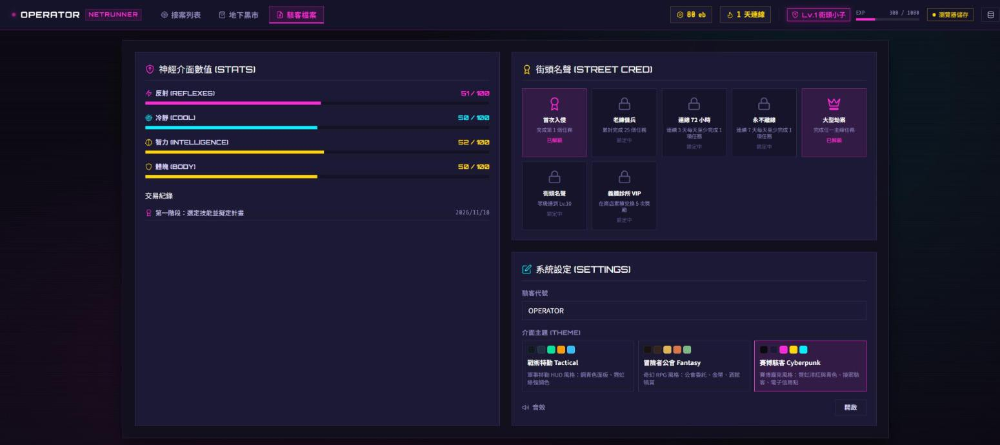

# Quest Terminal

> Beat procrastination by turning your life into a game.

**English** | [繁體中文](./README.zh-TW.md)

### ▶ [Play the live demo](https://ya3978.github.io/quest-terminal/) · [Download the desktop app](https://github.com/YA3978/quest-terminal/releases)

The demo runs entirely in your browser. Nothing to install, no sign-up, and your data stays on your device.



Quest Terminal is a desktop and web app that turns your to-do list into **missions**.
You split a big goal into small objectives you can check off. Each finished mission pays
**EXP** and **credits**: EXP levels up your character, and credits buy **real-life rewards**
that you define yourself in the shop. It's built to fight procrastination, and to make
self-improvement feel like a game you want to keep playing.

**One app, any game style.** Switch themes in the profile page, or [make your own](./docs/THEMING.md):

| Adventurer's Guild (fantasy RPG) | Netrunner (cyberpunk) |
|---|---|
|  |  |

## Why it helps with procrastination

| Problem | How the game handles it |
|---|---|
| "The task is too big, I don't know where to start" | Every mission is broken into small **objectives**. You only ever do the next checkbox. |
| "There's no reward for doing boring things" | Every mission pays out **EXP and credits** right away. |
| "I feel guilty when I relax" | Spend the credits you earned in the **reward shop**: one episode, a bubble tea, a gaming hour, all guilt-free. |
| "I keep breaking my habits" | **Daily missions** reset every day, and a **streak** counter rewards you for showing up. |
| "I can't see my progress" | **Levels, ranks, 4 attributes** (execution / discipline / knowledge / vitality) and **achievements**. |

## Features

- **4 mission types**:
  - main storylines (multi-stage, grouped)
  - side quests
  - daily missions (auto-reset at local midnight)
  - quick bounties
- **EXP and levels** with themed rank titles. Every level needs about 15% more EXP than the one before.
- **Credits and a reward shop**. You define the rewards and their prices.
- **Streaks**, **4 attribute stats**, **achievements**, and an action history.
- **Swappable themes**. Colors, fonts, and *all of the wording* change with the theme:
  - Tactical Ops (spec-ops HUD)
  - Adventurer's Guild (fantasy RPG)
  - Netrunner (cyberpunk)

  You can [make your own theme](./docs/THEMING.md).
- **Your data is yours**:
  - Desktop: plain, human-readable JSON files on your disk, with automatic daily backups.
  - Web: data stays in your browser.
  - Both: one-click JSON export and import.
- **AI-agent friendly**: an agent can add missions by editing the JSON files.
  See [AGENTS.md](./AGENTS.md) and [docs/DATA_FORMAT.md](./docs/DATA_FORMAT.md).
- Synthesized sound effects (no audio files, can be muted). No accounts, no tracking, no backend.

> The default UI language is Traditional Chinese. Every UI string lives in one file
> (`src/theme/strings.ts`), and a theme can override any of them, so an English UI is
> one theme file away. PRs welcome!

## Tech stack

React 19 · TypeScript · Tailwind CSS v4 · Vite · Tauri 2 (desktop shell, Rust)

## Getting started

### Prerequisites

| | Web version | Desktop app |
|---|---|---|
| [Node.js](https://nodejs.org/) 20.19+ (or 22.12+) | ✅ | ✅ |
| [Rust](https://www.rust-lang.org/tools/install) (stable) | – | ✅ |
| OS build tools | – | ✅ see [Tauri prerequisites](https://v2.tauri.app/start/prerequisites/) |

The OS build tools for the desktop app are:
- **Windows**: Microsoft C++ Build Tools and WebView2. WebView2 is preinstalled on Windows 10 and 11.
- **macOS**: Xcode Command Line Tools.
- **Linux**: `webkit2gtk-4.1` plus a few system packages. See the link above.

### Install

```bash
git clone https://github.com/YA3978/quest-terminal.git
cd quest-terminal
npm install
```

### Run the web version (fastest way to try it)

```bash
npm run dev
```
Open http://localhost:5173. Data is saved in the browser's localStorage.

### Run the desktop app

```bash
npm run tauri dev
```
The first run compiles the Rust side, which takes a few minutes. Later runs are fast.

### Build installers

```bash
npm run tauri build
```
The installers go to `src-tauri/target/release/bundle/`:
- Windows: `.msi` / `.exe`
- macOS: `.dmg` / `.app`
- Linux: `.deb` / `.rpm` / `.AppImage`

Pushing a tag like `v0.1.0` also builds them for all three platforms in GitHub Actions,
and attaches them to a draft release (see `.github/workflows/release.yml`).

> The prebuilt macOS download is for **Apple Silicon** (M1 and later). On an Intel Mac, build it yourself
> with `npm run tauri build`, or use the [web version](https://ya3978.github.io/quest-terminal/).

### Deploy the web version

`npm run build` produces a static site in `dist/` that works on any static host. It uses
relative asset paths, so it also works under a sub-path.

- **GitHub Pages**: enable *Settings → Pages → Source: GitHub Actions*. The included
  `.github/workflows/pages.yml` deploys on every push to `main`.
- **Vercel / Netlify / Cloudflare Pages**: build command `npm run build`, output directory `dist`.

On the web, each visitor's data stays in their own browser. Nothing is sent to a server.

## Where is my data?

| Version | Location |
|---|---|
| Desktop, Windows | `%APPDATA%\io.github.quest-terminal\` |
| Desktop, macOS | `~/Library/Application Support/io.github.quest-terminal/` |
| Desktop, Linux | `~/.local/share/io.github.quest-terminal/` |
| Web | the browser's localStorage for that site |

The desktop folder holds three files:
- `tasks.json`
- `profile.json`
- `rewards.json`

It also has a `backup/YYYY-MM-DD/` snapshot for each of the last 30 days you used the app.
The backup dialog (database icon, top right) shows the exact path, and can open the folder,
download a JSON backup, or import one.

**Editing the JSON by hand (or with an AI agent) is supported.** The app notices the change
the next time you switch back to its window and loads it. If you clicked something in the
app in the meantime, the files on disk win, so your edit is never overwritten. You may need
to redo that one click.

To restore a snapshot:
1. Close the app.
2. Copy the three files from a `backup/<date>/` folder into the data folder.
3. Start the app again.

## Customizing

- **Your missions and rewards**: create them in the app, or edit the JSON. The format is in
  [docs/DATA_FORMAT.md](./docs/DATA_FORMAT.md).
- **Starting data for new users**: `public/seed/*.json`.
- **Your own game style** (colors, fonts, names for everything): [docs/THEMING.md](./docs/THEMING.md).
- **Game rules** (EXP curve, achievements, ranks): `src/lib/gamification.ts`.

## Project structure

```
src/
  lib/          game rules & helpers (pure TS, no React): gamification, tasks, dates, validation, audio
  storage/      persistence backends: browserStorage (localStorage) / tauriFileStorage (JSON files)
  state/        store.tsx (load/save/conflicts) + actions.ts (user actions → sounds + toasts)
  theme/        strings.ts (all UI text), themes/*.ts, ThemeProvider
  components/   React UI
public/seed/    first-run sample data
src-tauri/      Tauri desktop shell (Rust) + capabilities (fs access limited to the app-data folder)
docs/           THEMING.md, DATA_FORMAT.md
```

## Contributing

Issues and PRs are welcome. See [CONTRIBUTING.md](./CONTRIBUTING.md). If you use AI coding agents,
point them at [AGENTS.md](./AGENTS.md).

## License

[MIT](./LICENSE)
