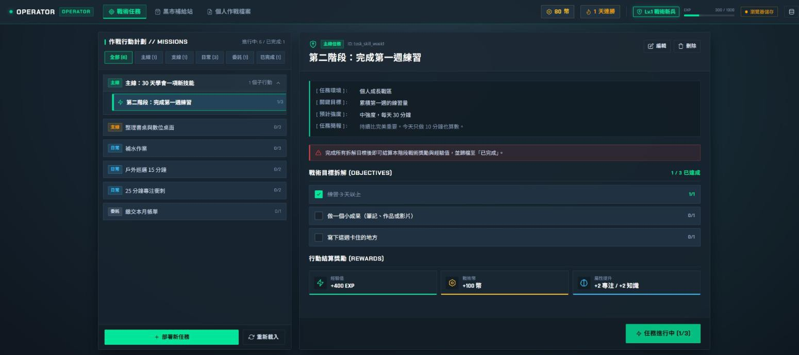
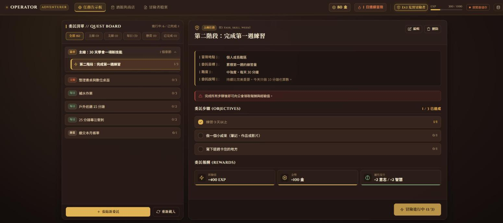
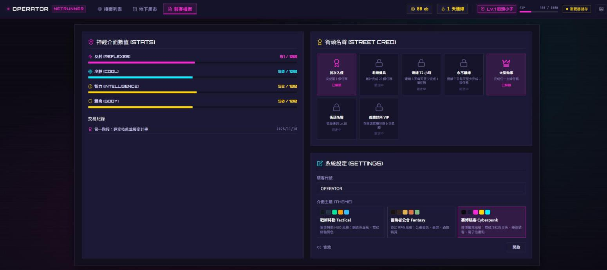

# Quest Terminal 任務終端

> 把人生變成一場遊戲，用打怪升級的方式戰勝拖延症。

[English](./README.md) | **繁體中文**

### ▶ [線上試玩](https://ya3978.github.io/quest-terminal/) · [下載桌面版](https://github.com/YA3978/quest-terminal/releases)

試玩版直接在瀏覽器執行：不用安裝、不用註冊，資料只存在你自己的裝置上。



Quest Terminal 是一個桌面／網頁應用程式，把你的待辦清單變成 **任務**：
把大目標拆成一個個可以打勾的小目標，完成任務就能獲得 **經驗值（EXP）** 與 **貨幣**。
經驗值讓角色升級，貨幣則可以在商店裡兌換 **你自己設定的現實獎勵**：一杯手搖飲、
追一集劇、一小時遊戲時間…。這是為了對付拖延症而做的工具，也是讓「自我成長」變得像遊戲一樣，
讓人想一直玩下去。

**同一個 App，任何遊戲風格。** 在個人檔案頁切換主題，或 [打造你自己的風格](./docs/THEMING.md)：

| 冒險者公會（奇幻 RPG） | 賽博駭客（Cyberpunk） |
|---|---|
|  |  |

## 為什麼對拖延症有幫助？

| 拖延的原因 | 遊戲化的解法 |
|---|---|
| 「事情太大，不知道從哪開始」 | 每個任務都拆成小小的 **子目標**，你只需要完成下一個勾勾 |
| 「做無聊的事沒有回饋」 | 每完成一個任務，立刻拿到 **EXP 與貨幣** |
| 「休息、娛樂時會有罪惡感」 | 用自己賺來的貨幣在 **獎勵商店** 兌換娛樂，名正言順、毫無罪惡感 |
| 「習慣總是斷掉」 | **每日任務** 每天自動重置，**連勝天數** 鼓勵你每天回來 |
| 「看不到自己的進步」 | **等級、稱號、四維屬性**（執行／專注／知識／體能）與 **成就勳章** |

## 功能

- **四種任務類型**：
  - 主線（可分階段、成組顯示）
  - 支線
  - 日常（每天本地時間午夜自動重置）
  - 臨時小任務
- **經驗值與等級**，搭配主題專屬的稱號。每一級所需的經驗值比上一級多約 15%。
- **貨幣與獎勵商店**：獎勵內容和價格都由你自己決定。
- **連勝天數**、**四維屬性**、**成就勳章**、**歷史紀錄**。
- **可切換主題**：顏色、字型、以及 *所有用詞* 都會跟著主題改變。
  - 戰術特勤（軍事 HUD 風格）
  - 冒險者公會（奇幻 RPG）
  - 賽博駭客（Cyberpunk）

  你也可以 [打造自己的遊戲風格](./docs/THEMING.md)。
- **資料完全屬於你**：
  - 桌面版：資料存成硬碟上人類可讀的 JSON 檔，每天自動備份。
  - 網頁版：資料存在瀏覽器裡。
  - 兩者都支援一鍵 JSON 匯出／匯入。
- **對 AI agent 友善**：agent 可以直接編輯 JSON 檔幫你新增任務。
  詳見 [AGENTS.md](./AGENTS.md) 與 [docs/DATA_FORMAT.md](./docs/DATA_FORMAT.md)。
- 音效即時合成（不需要音檔，可關閉）。沒有帳號、沒有追蹤、沒有後端伺服器。

## 技術

React 19 · TypeScript · Tailwind CSS v4 · Vite · Tauri 2（桌面殼層，Rust）

## 安裝與執行

### 事前準備

| | 網頁版 | 桌面版 |
|---|---|---|
| [Node.js](https://nodejs.org/) 20.19+（或 22.12+） | ✅ | ✅ |
| [Rust](https://www.rust-lang.org/tools/install)（stable） | – | ✅ |
| 作業系統建置工具 | – | ✅ 見 [Tauri 前置需求](https://v2.tauri.app/start/prerequisites/) |

桌面版需要的作業系統建置工具：
- **Windows**：Microsoft C++ Build Tools 與 WebView2。Windows 10、11 已內建 WebView2。
- **macOS**：Xcode Command Line Tools。
- **Linux**：`webkit2gtk-4.1` 等套件，詳見上方連結。

### 下載與安裝相依套件

```bash
git clone https://github.com/YA3978/quest-terminal.git
cd quest-terminal
npm install
```

### 執行網頁版（最快的試用方式）

```bash
npm run dev
```
打開 http://localhost:5173 。資料會存在瀏覽器的 localStorage。

### 執行桌面版

```bash
npm run tauri dev
```
第一次執行要編譯 Rust，需要幾分鐘，之後就很快了。

### 打包安裝檔

```bash
npm run tauri build
```
安裝檔會出現在 `src-tauri/target/release/bundle/`：
- Windows：`.msi` / `.exe`
- macOS：`.dmg` / `.app`
- Linux：`.deb` / `.rpm` / `.AppImage`

推送像 `v0.1.0` 這樣的 tag 時，GitHub Actions 也會自動打包三個平台的安裝檔，
並附加到一個草稿 Release（見 `.github/workflows/release.yml`）。

> 預先打包的 macOS 版本僅支援 **Apple Silicon**（M1 以後的機型）。Intel Mac 請用 `npm run tauri build` 自行打包，
> 或直接使用 [網頁版](https://ya3978.github.io/quest-terminal/)。

### 部署網頁版

`npm run build` 會在 `dist/` 產生純靜態網站，可以放到任何靜態主機。
資源路徑是相對路徑，所以放在子路徑下也能運作。

- **GitHub Pages**：到 *Settings → Pages → Source* 選 *GitHub Actions*。
  內附的 `.github/workflows/pages.yml` 會在每次 push 到 `main` 時自動部署。
- **Vercel / Netlify / Cloudflare Pages**：build 指令 `npm run build`，輸出目錄 `dist`。

網頁版的資料只存在每位使用者自己的瀏覽器，不會傳到任何伺服器。

## 我的資料存在哪？

| 版本 | 位置 |
|---|---|
| 桌面版，Windows | `%APPDATA%\io.github.quest-terminal\` |
| 桌面版，macOS | `~/Library/Application Support/io.github.quest-terminal/` |
| 桌面版，Linux | `~/.local/share/io.github.quest-terminal/` |
| 網頁版 | 該網站在瀏覽器裡的 localStorage |

桌面版資料夾裡有三個檔案：
- `tasks.json`
- `profile.json`
- `rewards.json`

另外，最近使用過的 30 天，每天都會在 `backup/YYYY-MM-DD/` 留一份快照。
右上角的資料庫圖示會打開備份視窗，裡面有確切路徑，也可以開啟資料夾、下載 JSON 備份或匯入備份。

**可以直接手動（或請 AI agent）編輯 JSON 檔。** 下次切回 App 視窗時，它會偵測到變更並自動載入。
如果你在這段期間已經在 App 裡點了別的東西，硬碟上的版本優先，所以你的編輯不會被覆蓋，
只是剛才那一步可能需要重做。

還原備份的步驟：
1. 關閉 App。
2. 把 `backup/<日期>/` 裡的三個檔案複製回資料夾。
3. 重新開啟 App。

## 客製化

- **你的任務與獎勵**：在 App 裡新增，或直接編輯 JSON。格式見 [docs/DATA_FORMAT.md](./docs/DATA_FORMAT.md)。
- **新使用者的預設資料**：`public/seed/*.json`。
- **換成你自己的遊戲風格**（顏色、字型、所有名稱）：見 [docs/THEMING.md](./docs/THEMING.md)。
- **遊戲規則**（經驗曲線、成就、稱號門檻）：`src/lib/gamification.ts`。

## 專案結構

```
src/
  lib/          遊戲規則與工具（純 TS，不依賴 React）：gamification、tasks、日期、資料驗證、音效
  storage/      儲存後端：browserStorage（localStorage）/ tauriFileStorage（JSON 檔）
  state/        store.tsx（載入/存檔/衝突處理）+ actions.ts（使用者操作 → 音效 + 提示）
  theme/        strings.ts（所有介面文字）、themes/*.ts、ThemeProvider
  components/   React 介面元件
public/seed/    第一次啟動的範例資料
src-tauri/      Tauri 桌面殼層（Rust）+ 權限設定（檔案存取僅限 App 資料夾）
docs/           THEMING.md、DATA_FORMAT.md
```

## 參與貢獻

歡迎開 Issue 或送 PR，詳見 [CONTRIBUTING.md](./CONTRIBUTING.md)。
如果你使用 AI coding agent，請讓它先讀 [AGENTS.md](./AGENTS.md)。

## 授權

[MIT](./LICENSE)
